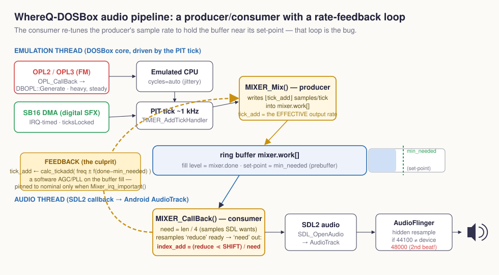
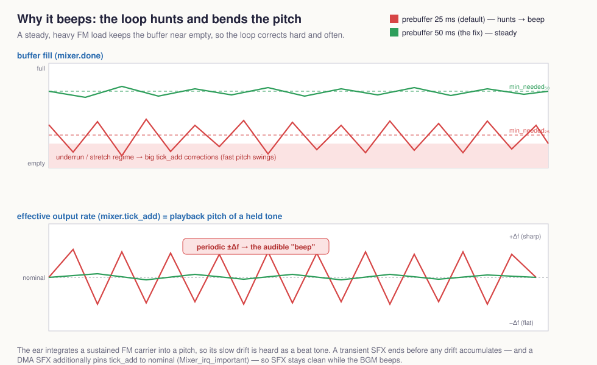
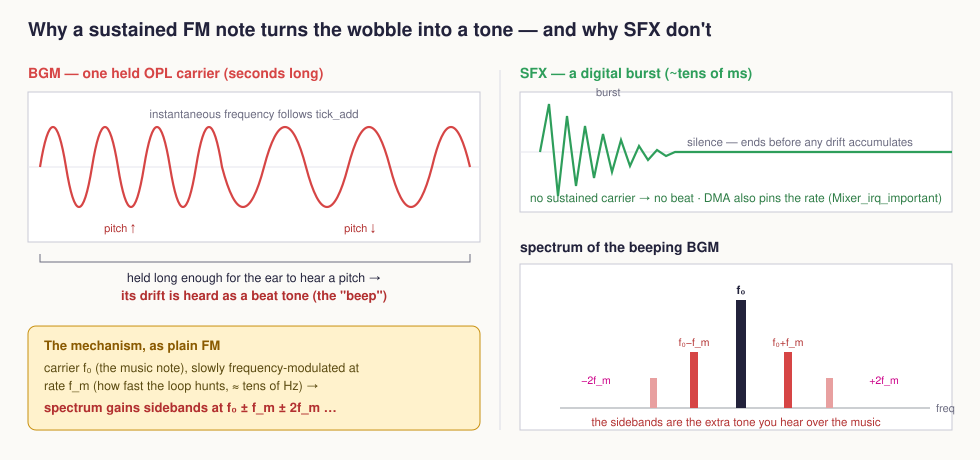

# The BGM "continuous beep": root cause and fix

**Scope.** A steady tone rode on top of the in‑game music (BGM) on a real phone.
It was present *only* while the FM music played — toggling a game's own music
switch (e.g. 三国志英杰传) removed it — and the digital sound effects stayed
clean. This document explains exactly why, down to the mixer control loop, and
why a three‑line audio‑buffer change in `dosbox.conf` fixes it.

**One‑sentence version.** DOSBox keeps the audio buffer centred by continuously
re‑tuning the emulator's *effective output sample rate*; under the steady, heavy
load of OPL/FM synthesis on a phone that control loop hunts, and because a held
FM note is a sustained carrier, the rate hunting frequency‑modulates it into an
audible beat tone — digital SFX are transient (and DMA‑timed) so they never
reveal it. Deepening the audio buffer (and matching the device's native 48 kHz)
keeps the loop in its gentle regime, and the tone disappears.

---

## 1. Background: how WhereQ‑DOSBox makes sound

Audio is a classic **two‑thread producer/consumer** with a twist: the producer's
*speed* is steered by a feedback loop.



- **Producer — the emulation thread.** DOSBox advances the emulated machine and,
  on every emulated PIT tick (~1 kHz, `TIMER_AddTickHandler(MIXER_Mix)`), runs
  `MIXER_Mix()`. That sums each sound source into the ring buffer `mixer.work[]`.
  The number of samples it writes per real second is governed by
  `mixer.tick_add` — **the effective output sample rate**.
  - The FM music is one source: `OPL_CallBack → DBOPL::Handler::Generate`
    (`src/hardware/adlib.cpp`, `src/hardware/dbopl.cpp`). FM synthesis is
    arithmetic‑heavy and runs **every block, steadily**, for as long as the music
    plays.
  - Digital SFX are another source: the Sound Blaster DSP playing DMA samples.

- **Consumer — the SDL2 audio thread.** Android's AudioTrack pulls fixed blocks
  through `MIXER_CallBack(stream, len)` (`src/hardware/mixer.cpp`). It needs
  `need = len/4` stereo samples and copies them out of `mixer.work[]`.

- **The twist — a software AGC/PLL on the buffer fill.** The producer and
  consumer are two independent clocks (the emulated PIT vs. the phone's audio
  clock) that will never agree exactly, and the emulator's throughput jitters.
  So on **every** callback DOSBox measures how full the buffer is (`mixer.done`)
  against a set‑point (`mixer.min_needed`, derived from the `prebuffer` ms) and
  nudges `mixer.tick_add`:

  ```c
  // src/hardware/mixer.cpp — MIXER_CallBack(), paraphrased
  if (mixer.done < need)             // starving: speed the producer up, and…
      mixer.tick_add = calc_tickadd(mixer.freq + mixer.min_needed);
  else if (buffer getting low)       // low: speed up proportionally
      mixer.tick_add = calc_tickadd(mixer.freq + diff*3);
  else if (buffer high)              // full: slow the producer down
      mixer.tick_add = calc_tickadd(mixer.freq - diff/5);
  // and the block actually played is RESAMPLED to hit `need` exactly:
  index_add = (reduce << TICK_SHIFT) / need;   // ← instantaneous pitch ratio
  ```

  Two things move together here, and both matter:
  1. `mixer.tick_add` — the rate at which future audio is *produced*.
  2. `index_add` — the ratio at which the *current* block is resampled to fill
     `need`. When fewer samples are ready than needed (`reduce < need`), the
     block is **stretched** (`index_add < 1`) and plays back **lower**; when more
     are ready, it is **compressed** and plays **higher**.

`index_add` is literally the instantaneous pitch multiplier applied to whatever
is in the buffer — including a sustained music note. Hold that thought.

---

## 2. Root cause: the loop hunts, and hunting bends the pitch

The feedback loop is stable and inaudible **when the buffer sits comfortably
above empty**. It becomes audible when the buffer is forced to live near empty,
because then the controller spends its time in the aggressive branches
(speed‑up + stretch), making large, repeated corrections.

Three facts drive it there, specifically for FM music on a phone:

1. **FM is a heavy, *steady* consumer of production.** `DBOPL::Generate` runs
   every block. Unlike a short SFX, it never lets the buffer "catch its breath,"
   so `mixer.done` hovers low.
2. **`cycles=auto` makes the producer's throughput jitter.** The CPU governor
   re‑targets cycles to track real time, the dynrec occasionally flushes its
   cache, and the Android scheduler/thermal state perturbs each slice. Every
   perturbation is a small production stall that the loop must correct.
3. **The default buffer is shallow.** Desktop defaults — `prebuffer = 25 ms`,
   `blocksize = 1024` — leave little slack, so step (2)'s stalls routinely push
   `mixer.done` into the underrun/stretch regime.

The result is a limit cycle: stall → buffer dips → loop raises `tick_add` and
stretches the block (pitch dips) → buffer refills/overshoots → loop lowers
`tick_add` (pitch rises) → repeat, tens of times a second. The **effective
output rate oscillates**, which is the same as saying **the playback pitch
oscillates**.



*Top:* with the shallow default buffer (red) the fill repeatedly dips into the
stretch regime, forcing big corrections; the deep buffer (green) stays in the
gentle‑trim band. *Bottom:* those corrections are a periodic ±Δf on the output
rate — i.e. on the pitch of any held tone. That periodic pitch wobble is the
beep.

### Why a *held FM note* is audible but SFX are not

A sustained carrier is what lets the ear turn the wobble into a tone:



- **BGM is a sustained carrier `f₀`.** Slowly frequency‑modulating it at the
  hunting rate `f_m` (tens of Hz) is textbook FM: the spectrum sprouts
  **sidebands at `f₀ ± f_m`, `f₀ ± 2f_m` …**. Those sidebands are extra partials
  that were not in the music — the tone you hear over it. The note is held for
  seconds, so the ear fully integrates them.
- **SFX are transient.** A digitised effect lasts tens of milliseconds and then
  stops. It ends before the slow rate drift accumulates into an audible pitch
  change, so there is no sustained carrier to grow sidebands on.
- **And DMA audio is explicitly protected.** When a sound card's DMA/IRQ timing
  must be honoured the mixer pins the rate to nominal instead of nudging it:

  ```c
  // src/hardware/mixer.cpp
  static inline bool Mixer_irq_important(void) {
      return (ticksLocked || (CaptureState & (CAPTURE_WAVE|CAPTURE_VIDEO)));
  }
  if (Mixer_irq_important()) mixer.tick_add = calc_tickadd(mixer.freq); // no wobble
  ```

  Digital SFX play through DMA windows that raise this flag, so the rate‑nudging
  — and therefore the wobble — is suppressed exactly when SFX are the audio that
  matters. Register‑driven OPL FM has no such window, so it takes the full
  wobble. This is the code‑level reason the split is **BGM beeps / SFX clean**,
  on top of the perceptual (sustained vs. transient) reason.

### What it is *not* (ruled out by reading the code)

- **Not** an OPL emulation defect. `dbopl` is built with the high‑precision
  `DBOPL_WAVE == WAVE_TABLEMUL` path (`src/hardware/dbopl.h`), not the lossy
  `WAVE_HANDLER`. The OPL mixer channel is enabled during play and only
  auto‑disabled after 30 s of silence (`OPL_CallBack`) — there is no stuck
  operator or idle tone.
- **Not** a buffer‑format/rate mismatch bug. The mixer adopts whatever SDL
  returns (`mixer.freq = obtained.freq; mixer.blocksize = obtained.samples;`),
  so there is no silent format war.
- **Not** a logic bug at all — every line involved is stock DOSBox behaving as
  designed. It is a *tuning* mismatch: desktop buffer defaults on a phone‑class,
  jittery, FM‑heavy workload.

---

## 3. The fix

A phone‑appropriate `[mixer]` block was added to the shipped configuration
(`android/app/src/main/assets/dosbox.conf`). It changes **audio buffering only** —
never game speed, timing, or logic.

```ini
[mixer]
rate=48000       ; was 44100
blocksize=2048   ; was 1024
prebuffer=50     ; was 25 (ms)
```

How each line attacks the mechanism from §2:

| setting | default | new | why it helps |
|---|---|---|---|
| `prebuffer` | 25 ms | **50 ms** | Raises the loop's set‑point (`min_needed`) and headroom, so a production stall is *absorbed* instead of forcing the stretch/speed‑up branch. This is the dominant fix — it keeps the controller in its gentle‑trim band (green trace), collapsing the ±Δf wobble below audibility. |
| `blocksize` | 1024 | **2048** | Halves the callback frequency and widens the stable window (`max_needed = blocksize*2 + 2*min_needed`), so per‑callback jitter is a smaller fraction of a block. |
| `rate` | 44100 | **48000** | Matches the native rate of most modern phones, so Android's AudioFlinger does not insert its *own* hidden 44100→48000 resampler beneath SDL — a second, independent resampler that can beat against a held FM note. DOSBox then renders natively at 48 kHz (it adopts `obtained.freq`). |

Cost: audio latency rises by roughly the added prebuffer (~50 ms). For a DOS
game with no tight audio/visual sync requirement this is inaudible, and it is a
deliberate trade — latency for the absence of the tone.

### Why this placement is correct

`WhereqDosboxActivity.writeConfig()` regenerates `dosbox.conf` from this asset on
**every** boot (copying it verbatim, only rewriting the `core=` line and
appending the autostart). So editing the asset is the single source of truth; the
`[mixer]` block reaches every game, every launch, with no per‑game action.

### Result

On device the tone is gone: BGM plays clean, SFX unchanged. Confirmed by the
reporter (三国志英杰传, BGM on).

---

## 4. If it ever regresses — ordered fallback levers

Each is an independent one‑line config change, A/B‑testable by ear:

1. **Deepen further** — `prebuffer=80` (or `blocksize=4096`) if a slower/older
   device still hunts. Same lever, more margin.
2. **Stop the governor hunting** — replace `cycles=auto` with a fixed budget:
   `cycles=max` (dynrec flat‑out; the standard recommendation for this class of
   symptom) or a fixed `cycles=20000`. This removes driver (2) of the limit
   cycle. Bigger hammer: it changes game speed/feel, so test per game.
3. **If the tone is actually the PC speaker** (a game whose music routine drives
   PIT channel 2), `[speaker] pcspeaker=false` kills it — but also any legitimate
   PC‑speaker SFX, so confirm the game's SFX are Sound Blaster first (they are,
   here).
4. `oplrate=49716` (the OPL's native rate) — likely **moot** for the default
   `dbopl` handler, which renders directly at the mixer rate; it only affects the
   MAME/compat OPL cores. Harmless to try.

---

## 5. Code map (for the next reader)

- `src/hardware/mixer.cpp`
  - `MIXER_CallBack()` — the consumer and the control loop (the §2 branches).
  - `MIXER_Mix()` / `MIXER_MixData()` — the producer, paced by `mixer.tick_add`.
  - `calc_tickadd()` — converts a target Hz into a per‑tick sample increment.
  - `Mixer_irq_important()` — the DMA/IRQ guard that pins the rate (protects SFX).
  - `MIXER_Init()` — reads `rate` / `blocksize` / `prebuffer`; `SDL_OpenAudio`.
- `src/hardware/adlib.cpp` — `OPL_CallBack`, `Module::PortWrite`, channel enable.
- `src/hardware/dbopl.{h,cpp}` — the FM engine; `DBOPL_WAVE == WAVE_TABLEMUL`.
- `android/app/src/main/assets/dosbox.conf` — the shipped config; the `[mixer]`
  block lives here.
- `WhereqDosboxActivity.writeConfig()` — copies the asset verbatim each boot.

Diagrams: `diagrams/audio-fm-beep-pipeline.svg`, `diagrams/audio-fm-beep-controlloop.svg`,
`diagrams/audio-fm-beep-modulation.svg`.
